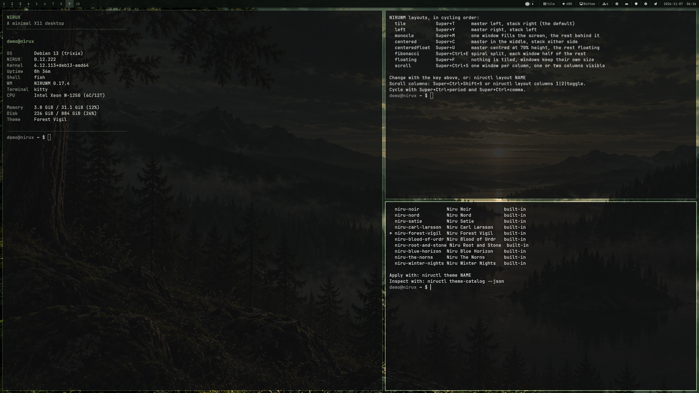

# NIRUWM

Small Rust/X11 tiling window manager and session layer at the heart of the NIRUX desktop.

**Status: beta** · Part of the [NIRUX](https://github.com/nirucon/nirux) suite · [MIT License](LICENSE)



## About

NIRUWM is the window manager of NIRUX. It is built in the spirit of
[suckless dwm](https://dwm.suckless.org/), which I used for many years, but it
is its own code and its own design, not a dwm fork or configuration.

It keeps what makes dwm pleasant: tags instead of virtual desktops, a single
plain-text configuration, keybindings as the primary interface and a codebase
small enough to read. It adds what a daily machine needs: per-monitor
workspaces, eight layouts, scratchpads, session save/restore, display
profiles, and the `niructl` and `niruidle` tools that the rest of the suite
(NIRUBAR, NIRU Launcher, NIRUNOTIFY, NIRULOCK and friends) builds on.

The repository also ships the session scripts: `niruwm-session` (what the
display manager starts), `niruclipboard` (clipboard history helper) and
`nirugestured` (touchpad gestures). NIRU Login starts this session.

## Features

- Eight layouts: tile, left, monocle, centered, centered-floating, fibonacci,
  floating and Scroll. Scroll keeps one window per column and shows one or two
  adjacent columns, sliding horizontally with focus.
- Ten workspaces per monitor (`Super+1`…`Super+0`); layout, master ratio and
  master count are stored per workspace and survive a logout.
- Tiling, floating, fullscreen, sticky windows, gaps, master ratio/count and
  window swapping; dwm-style `Super`+drag to move and resize.
- Scratchpads: one default (`Super+Shift+S`) and nine numbered slots
  (`Super+Alt+1…9`); any window can be sent to a slot. A shown scratchpad
  stays on top until you hide it, and its dialogs (an Open or Save dialog,
  for example) stay above it and are hidden and shown with it.
- Window swallowing, on by default: a program started from a terminal
  (`mpv`, `zathura`, `feh`, …) takes the terminal's place, and the terminal
  comes back where it was when the program closes.
- Urgency like dwm: a window that asks for attention gets the attention
  colour as its border and on its workspace cell in NIRUBAR, and
  `Super+Shift+U` goes to it.
- A crash of the window manager does not end the session: `niruwm-session`
  starts it again, and every open window keeps its workspace and scratchpad;
  a swallowed terminal stays hidden behind its program.
- Update without logging out: `niructl restart-wm` runs the installed NIRUWM
  in the same session. Every window keeps its screen, workspace, floating or
  tiled state, place in the layout and focus; each workspace keeps its layout;
  the shown scratchpad stays shown and hidden windows never flash up. The
  session helpers whose program changed (NIRUNOTIFY, NIRUIDLE, the clipboard
  and gesture daemons, NIRUSHARE, the display and night-light watchers) are
  replaced; a lock screen is never touched, and while the screen is locked
  the restart waits for the unlock. If the new manager fails at once, the
  session goes back to the previous one.
- Window rules for floating, centering, workspace, sticky and compositor opacity.
- Session save/restore, autostart, workspace recipes and focus/presentation
  modes through `niructl`.
- Studio mode for recording (`niructl studio`): no screen saver, lock or
  popups, picom off and the performance profile while it is on, everything
  put back as it was afterwards; optionally on while REAPER is open.
- Calendar events in the bar: the bundled NIRUBAR (0.23) shows read-only
  ICS feeds, such as Google Calendar's secret iCal address, in the clock's
  calendar (day markers, an agenda, click to open the day in the browser),
  and a reminder notification 10 minutes before each timed event
  (`remind_minutes` in `calendars.toml`, 0 is off).
  An edited `calendars.toml` takes effect by itself within seconds, or at
  once with `niructl reload`.
  See the [NIRUBAR docs](https://github.com/nirucon/nirubar/blob/main/docs/CONFIGURATION.md#calendar-events).
- Bar panels you read (calendar, weather, tasks, pulse, notifications) stay
  open until dismissed; quick panels keep `popup_timeout_seconds`. Per-panel
  overrides go in `[popup_timeout]` in `~/.config/nirubar/config.toml`, not in
  this config ([NIRUBAR docs](https://github.com/nirucon/nirubar/blob/main/docs/CONFIGURATION.md#display-and-panels)).
- Display profiles that follow screens by EDID identity, with optional
  automatic switching on hotplug and lid events.
- Shared NIRU themes (ten built in, plus user themes), theme wallpapers per
  screen and a theme hook for terminal colours.
- Native integration for notifications, DND, audio, microphone, Bluetooth,
  power profiles, brightness, night light and screenshots.
- `niructl`: one control command for the whole suite (themes, bar, layouts,
  wallpaper, displays, audio, input, power, diagnostics, tasks and the optional
  OpenCode handoff).
- `niruidle`: idle, screensaver, lock and DPMS timing in one process without a
  separate idle daemon: active → screensaver → locked → display off.

## Requirements

- Debian, Arch or Void Linux (glibc), x86_64.
- An X11 server; NIRUWM is not a Wayland compositor.
- Runtime helpers used when present: `feh` (or `hsetroot`, `nitrogen`,
  `xwallpaper`) for wallpapers, `picom` for the compositor, `dbus-send` for
  power actions, `brightnessctl`, `xrandr`, PipeWire/PulseAudio tools.
  The default terminal is `kitty`, the default browser `brave` and the file
  manager `pcmanfm`; all can be changed.
- Building from source: Rust 1.75 or newer and a C linker.

NIRUX installs all runtime dependencies for you.

## Installation

### With NIRUX

NIRUWM is a core component. `nirux install` installs it together with the rest
of the suite from the pinned manifest, and `nirux update` keeps it current. See
the [NIRUX README](https://github.com/nirucon/nirux#installation).

### Standalone

To install NIRUWM and its session tools on an existing X11 system:

```sh
git clone https://github.com/nirucon/niruwm
cd niruwm
./install.sh --register-session
```

`./install.sh` downloads the released binaries (`niruwm`, `nirubar`, `niructl`,
`niruidle` and the session scripts) into `~/.local/bin`, creates
`~/.config/niruwm/config.toml` from the example and copies the bundled themes.
`--register-session` also adds `/usr/share/xsessions/niruwm.desktop` (needs
sudo), so you can choose **NIRUWM** at login. Other options:

| Option | Effect |
|---|---|
| `--build` | Build from this checkout instead of downloading (needs Rust) |
| `--check` | Verify the installed session, change nothing |
| `--prefix DIR` | Install under `DIR` instead of `~/.local` |
| `--uninstall` | Remove what this installer installed |

The standalone installer refuses to touch files that NIRUX manages; on a NIRUX
system use `nirux update`.

For a TTY login without a display manager, run
`startx "$HOME/.local/bin/niruwm-session"`.

## Usage

The most important keys (the full list is in
[docs/KEYBINDINGS.md](docs/KEYBINDINGS.md)):

| Keys | Action |
|---|---|
| `Super+Enter` | Terminal |
| `Super+P` | Application launcher |
| `Super+Shift+P` | Unified launcher: applications, windows, actions and settings |
| `Super+A` | NIRU Actions |
| `Super+V` | Clipboard history |
| `Super+/` or `Super+F1` | Keybinding cheat sheet: search, run, Ctrl+R asks what a key does. On layouts where "/" is Shift+7 (Swedish, German, …) Super+/ is the workspace 7 key, so use Super+F1 there |
| `Super+Shift+F1` | The NIRUX manual: search chapters and headings, Enter opens the section |
| `Super+.` | Emoji and symbol picker |
| `Super+O` | Find files in the home folder |
| `Super+Ctrl+C` | Pick a color from the screen (`nirushot pick`) |
| `Super+Ctrl+O` | Copy the text in a screen region (`nirushot ocr`) |
| `Alt+Tab` / `Super+grave` | Window switcher / workspace overview |
| `Super+1…9`, `Super+0` | Select workspace 1…10 |
| `Super+Shift+1…9`, `Super+Shift+0` | Move window to workspace 1…10 |
| `Super+J` / `Super+K` | Next / previous window |
| `Super+T` / `Super+M` / `Super+Ctrl+S` | Tile / monocle / Scroll layout |
| `Super+Shift+Space` | Toggle floating |
| `Super+Shift+E` | Toggle fullscreen |
| `Super+Shift+S` | Show / hide the default scratchpad |
| `Super+Alt+S` | Toggle sticky |
| `Super+Shift+U` | Go to the window that asked for attention (urgent) |
| `Super+Escape` | Lock |
| `Super+Q` | Close window |
| `Super+R` | Reload configuration |
| `Super+Ctrl+Shift+Q` | Log out |

`niructl` controls the running session from scripts and the terminal:

```sh
niructl reload                       # reload WM, bar and theme
niructl keys --json                  # every key in effect, with words (the cheat sheet)
niructl keys run super+t             # run what a key is bound to
niructl theme niru-nord              # switch theme
niructl layout monocle               # this workspace only
niructl scratchpad 2 toggle
niructl urgent                       # windows that asked for attention; `urgent focus` goes there
niructl swallow off                  # window swallowing for this session (on|off|toggle|status)
niructl studio on                    # studio mode: no saver/lock/popups, picom off, performance
niructl bar bottom
niructl display save Desk            # save the current screen layout
niructl display apply Desk
niructl timing set screensaver_timeout 20
niructl explain                      # what is going on with this session
niructl lock                         # lock: manual in a terminal, silent from scripts/SSH
niructl lock --silent                # lock without NIRULOCK pause music (rollouts, scripts)
niructl lock --manual                # lock as if by hand (pause music may play)
```

NIRULOCK (0.25+) plays its optional pause music only for a manual lock.
Each caller tells it why it locks, through `NIRULOCK_REASON` (an older
NIRULOCK ignores it and locks as before): `Super+Escape` and the launcher's
lock actions are `manual`; NIRUIDLE is `idle`; the lock before suspend,
`Super+Shift+Escape` and `niructl suspend` are `suspend`. Plain `niructl lock`
is `manual` when typed in a terminal (stdin is a TTY) and `script` otherwise,
so an SSH command, cron job or script never starts music; `--manual`,
`--silent` (`script`) and `--reason manual|idle|suspend|script|session` say it
explicitly. A wrong option never prevents the lock: niructl warns and locks
silently.

The program itself has a few diagnostic options:

```sh
niruwm --check-config     # validate config.toml without applying it
niruwm --reset-config     # restore the full example; keeps a .niruwm-backup copy
niruwm --doctor
niruwm --dump-config
niruwm --version
```

See [docs/REFERENCE.md](docs/REFERENCE.md) for the complete `niructl`
reference: themes, wallpapers per screen, layouts, displays, audio, input,
power and the compositor.

## Configuration

Everything lives in one file, `~/.config/niruwm/config.toml` (XDG paths are
respected), shared by NIRUWM, NIRUBAR, `niruidle` and `niructl`. Start from
the fully commented [config.example.toml](config.example.toml). An unknown key
is rejected, so a typo is visible instead of silent; an invalid file keeps the
previous settings in effect.

| Section | Contents |
|---|---|
| top level | `theme`, `gap`, `border_width`, `bar_height`, `master_ratio`, `terminal`, `browser`, `launcher`, `font_size`, weather coordinates |
| `[wallpaper]`, `[[wallpaper.outputs]]` | Theme wallpapers, single file, scale, rotation, per-screen pictures |
| `[autostart]`, `[[recipes]]` | Programs started at login, workspace recipes |
| `[nightlight]`, `[brightness]` | Night light and brightness |
| `[monitors]` | Per-workspace layouts, master ratios and counts, per-screen profiles |
| `[idle]` | `screensaver_timeout`, `lock_after_screensaver`, `dpms_off_after_lock` (minutes, default 15 each; `lock_after_screensaver = 0` locks at `screensaver_timeout` instead of showing the screensaver first) |
| `[bar]` | NIRUBAR modules and appearance (see the [NIRUBAR docs](https://github.com/nirucon/nirubar)) |
| `[scratchpad]`, `[[scratchpad.slot]]` | Default scratchpad command and size, `hide_on_focus_loss`, numbered slots |
| `[swallow]` | Window swallowing: `enabled` (default `true`), `terminals`, `exclude` |
| `[studio]` | Studio mode: `idle`, `dnd`, `compositor` (default `true`), `power_profile` (`performance`), `auto_enable` (`false`), `daw_classes` (`["REAPER"]`) |
| `[[rules]]` | Window rules: `class`, `workspace`, `floating`, `center`, `sticky`, opacity |
| `[[keys]]` | Key bindings; an entry with the same keys replaces a default, `action = "unbind"` removes one; an optional `description` is shown in the cheat sheet |

### Scratchpads and focus

A shown scratchpad stays on top of everything on its screen until you hide it
with its key (or `niructl scratchpad`). When the mouse moves onto another
window, that window gets the keyboard focus as usual, but the scratchpad stays
visible above it. If you prefer a scratchpad that hides itself as soon as
another window gets the focus, set this in `[scratchpad]`:

```toml
[scratchpad]
hide_on_focus_loss = true   # default: false
```

A dialog that belongs to a scratchpad does not count as another window: the
scratchpad stays open while its dialog has the focus.

### Window swallowing and urgency

When a terminal starts a program that opens a window, the window takes the
terminal's place: same workspace, same position in the tiling order, the
terminal's size when it floats. The terminal is hidden until the window
closes, then it comes back in place with the focus. Terminals are recognised
by window class, the program by its process (`_NET_WM_PID`, or the X server's
client PID), whose parent chain must lead to the terminal. Dialogs,
scratchpads, windows a rule sends to a workspace, other terminals and the
classes in `exclude` never swallow. Swallowing is on when `[swallow]` is
absent; `niructl swallow off` turns it off until the next login:

```toml
[swallow]
enabled = true                       # default
# terminals = ["kitty", "XTerm"]     # replaces the built-in list
# exclude = ["firefox", "mpv"]       # replaces the built-in list
```

A window that sets the ICCCM urgency hint or `_NET_WM_STATE_DEMANDS_ATTENTION`
(a terminal bell, a chat message) is marked unless it has the focus: its
border and its workspace cell in NIRUBAR take the theme's attention colour.
`Super+Shift+U` (or `niructl urgent focus`) goes to the most recent one,
switching screen and workspace or showing its scratchpad; the focus clears
the mark. Activation requests (`_NET_ACTIVE_WINDOW`) from pagers, window
switchers and notifications are always honoured, so they never need a mark.

### Studio mode

One switch for recording sessions: `niructl studio on|off|toggle|status`, the
`studio_toggle` key action, or *Studio mode* in the launcher. While it is on
the screen saver, idle lock and display-off wait (for this session only),
Do Not Disturb is on, picom is stopped and the power profile is
`performance`; NIRUBAR shows *studio*. Off puts back exactly what it changed:
DND that was already on stays on, a compositor that was not running is not
started, a power profile you changed meanwhile is kept. The state lives on the
X root window, so it survives a window manager restart and ends with the
session; a logout can never leave the machine without its idle lock.
`[studio]` chooses the items, the profile, and whether a DAW window (REAPER)
turns it on by itself (`auto_enable`, default off).

```toml
[studio]
power_profile = "performance"   # "keep" leaves it alone
auto_enable = false             # true: REAPER opening turns it on
```

The default workspace labels are numbers 1–10; to use icons or names, edit
`[bar] tags` using the presets commented in the example. After editing, press
`Super+R` or run `niructl reload`.

Session options (keyboard layout, notification provider, picom, idle) live in
`~/.config/niruwm/session.conf`; see
[docs/REFERENCE.md](docs/REFERENCE.md#session). Display profiles live in
`~/.config/niruwm/displays.toml`; see
[docs/display-profiles.md](docs/display-profiles.md).

## Files and paths

| Path | Purpose |
|---|---|
| `~/.config/niruwm/config.toml` | Shared configuration |
| `~/.config/niruwm/session.conf` | Session options (shell syntax) |
| `~/.config/niruwm/displays.toml` | Saved display profiles |
| `~/.config/niruwm/themes/` | Bundled copies and user themes |
| `~/.local/share/niru/keys.d/<app>.toml` | Keys other programs grab themselves, for the cheat sheet (see [KEYBINDINGS.md](docs/KEYBINDINGS.md#keys-of-other-programs-keysd)) |
| `~/.local/bin/niruwm`, `niructl`, `niruidle`, `niruwm-session`, `niruclipboard`, `nirugestured` | Programs |
| `~/.local/state/niruwm/session.log` | Session and WM log, capped at 8 MB; older lines in `session.log.1`…`.3` |
| `~/.local/state/niruwm/manifest.tsv` | Files installed by the standalone installer |
| `/usr/share/xsessions/niruwm.desktop` | Display-manager session entry |

## Troubleshooting

- **A config change did nothing.** Run `niruwm --check-config`; the error is
  also written to `~/.local/state/niruwm/session.log`.
- **The session does not start from a TTY.** Check the session log; the
  session creates a private runtime directory when the login provides none.
- **Wallpapers no longer follow the theme.** `niructl wallpaper status` shows
  why; `niructl wallpaper follow-theme on` returns to theme wallpapers, and
  `niructl theme NAME` repairs a config without a `[wallpaper]` section.
- **Windows ended up on a screen that is gone.** `niructl windows rescue`
  moves them back to a connected display.
- **A display profile does not apply.** `niructl display doctor` explains what
  matches and what is missing.
- **The screen went back to the login screen.** The session log says why. A
  deliberate quit is logged as `quit requested ...`; a crash as `niruwm
  stopped with status N ... starting it again`. After a crash the window
  manager is started again with the open windows; only four crashes within a
  minute end the session.
- **A new version is installed but nothing changed.** Log out and back in; a
  running window manager is not replaced by an update.

## Uninstall

With NIRUX, use `nirux uninstall`. A standalone install is removed with:

```sh
./install.sh --uninstall
```

Your configuration in `~/.config/niruwm` is kept; delete it manually for a
clean slate.

## Building from source

```sh
cargo build --release --locked
cargo fmt --check
cargo clippy --all-targets -- -D warnings
cargo test --locked
```

The shell tests in `tests/` are run by CI against the release build. Notes on
the window lifecycle and bar reliability work are in
[docs/window-lifecycle-fix.md](docs/window-lifecycle-fix.md) and
[docs/agent-window-lifecycle-oneshot.md](docs/agent-window-lifecycle-oneshot.md).

## Status, disclaimer and how it's made

**Status: beta.** NIRUWM runs my desktop every day on Debian, Arch and Void;
the core is stable for me, while newer pieces such as the Scroll layout and
automatic display switching still get regular fixes.

NIRUX and every niru* project are made by me, Nicklas Rudolfsson
([@nirucon](https://github.com/nirucon)), for me. They are tailored to my own
needs, preferences and workflows, on my own machines. If they fit yours too,
that's a nice bonus.

- **Free and open source.** Anyone is free to use, study, change and share
  it under the [MIT License](LICENSE).
- **No guarantees.** There is no warranty of any kind. Use it at your own
  risk, read what you install and keep backups of anything that matters.
- **How it's made.** Some of these projects I built from scratch by hand. In
  more recent releases I have used Claude, Anthropic's AI, to do much of the
  heavy lifting under my direction: I decide what to build and how it should
  behave, and I test it on my own machines. It saves me a lot of time, and
  the result is quite OK.
- **Alpha, beta, dev, and maybe forever.** Most things here are alpha, beta
  or dev, and may stay that way. Maybe one day there will be a real stable
  release, but given how fast development moves, and how I am as a person,
  maybe never :)

| Label | Meaning |
|---|---|
| dev | Under active construction; may not build, install or work yet. |
| alpha | Works on my machines, but incomplete or rough; expect breaking changes. |
| beta | In daily use on my machines and mostly complete; rough edges remain. |

## License

MIT License, see [LICENSE](LICENSE). Copyright (c) 2026 Nicklas Rudolfsson.
